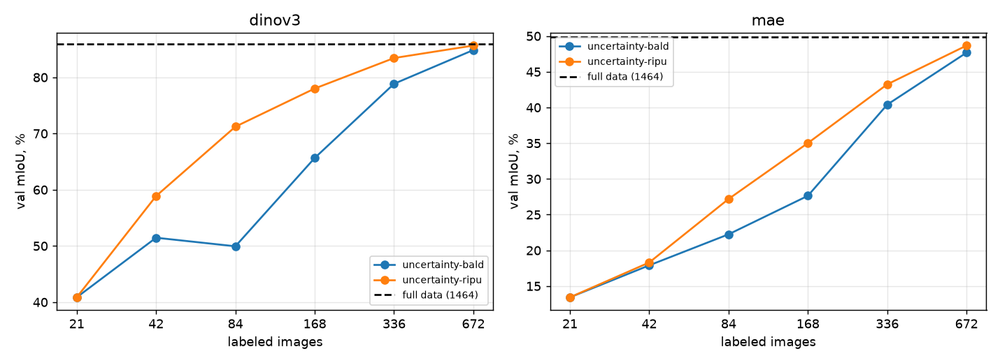
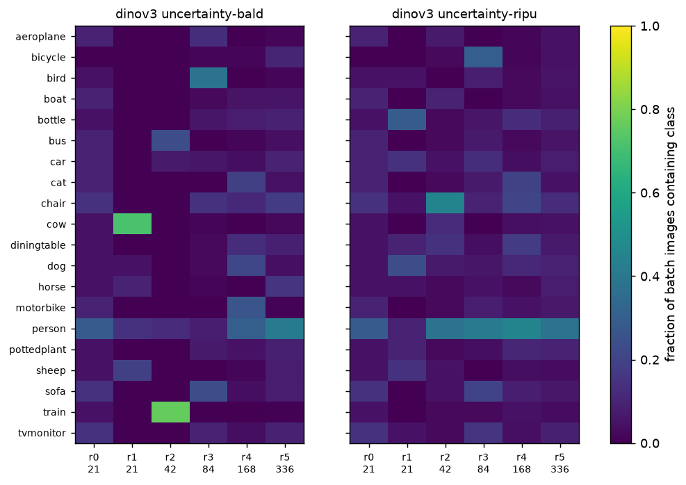

# Active learning for semantic segmentation — Pascal VOC 2012

Which images should we pay to annotate? We compare selection strategies under a fixed labeling budget,
using frozen self-supervised encoders and a small segmentation head retrained from scratch every round.

## 1. Setup

| | |
|---|---|
| **Data** | VOC 2012 seg. `train` (1464) = **pool 1264** + **dev 200** (seed 0, every class in ≥ 5 dev images). `val` (1449) is used for reporting only. Void label 255 is ignored. |
| **Oracle** | Returns masks only for queried IDs, logs every query, and refuses repeats. Selectors never get the Oracle. |
| **Encoders (frozen)** | DINOv3 ViT-B/16 (`facebook/dinov3-vitb16-pretrain-lvd1689m`, layers 6 + 12), MAE ViT-B/16 (timm `vit_base_patch16_224.mae`, layers 6 + 9). Input 448 → 28×28 tokens. |
| **Head (~0.5 M params)** | Per layer: LayerNorm → 1×1 conv 768→256. Concat → 1×1 conv 512→256 → GELU → Dropout 0.1 → 1×1 conv →21, then bilinear upsampling. |
| **Recipe (identical everywhere)** | CE loss, AdamW lr 1e-3, wd 1e-4, 50 warmup steps + cosine, batch 8, **1000 steps**, no augmentation. |
| **Budgets** | Cumulative 21 → 42 → 84 → 168 → 336 → 672 labeled images, seed 0. |
| **Cold start** | Round 0 is the **MaxHerding** batch for every model-based method (σ = median pairwise distance of mean-pooled, L2-normalised image vectors). |
| **Metrics** | val mIoU (21 classes), per-class IoU, pixel ECE (15 bins), **AUBC** (area under the mIoU vs log-budget curve, normalised), dev mIoU, cost proxies: object instances and object-boundary pixels of the selected images. |

**Uncertainty scorers.** Each method gives an uncertainty value per pixel. The image score is the mean of its top 10% most uncertain pixels, so a small uncertain object isn't averaged away by easy background.

- **RIPU:** region impurity × prediction uncertainty. It multiplies (a) the entropy of the *predicted labels* in a 3×3 window by (b) the mean softmax entropy in the same window. It's high where several classes meet *and* the model is unsure.
- **BALD:** mutual information H(mean p) − mean H(p) over **5 bootstrap heads** trained on resampled L. This is epistemic uncertainty, i.e. disagreement between the heads.

## 2. Full-data upper bound (all 1464 train images, 3 seeds)

| Encoder | val mIoU | ECE | Train time (T4) | Hardest classes (IoU) |
|---|---|---|---|---|
| DINOv3 ViT-B/16 | **85.93 ± 0.15** | 0.004 | ~117 s | chair 57.5 · pottedplant 64.3 · bicycle 68.5 |
| MAE ViT-B/16 | **49.88 ± 0.29** | 0.004 | ~116 s | chair 17.7 · pottedplant 21.4 · bicycle 28.1 |

Same model size (ViT-B/16), very different features: DINOv3 is +36 mIoU. Under the fixed 1000-step recipe MAE is still slowly improving (val 28 → 40 → 46 → 49 → 50 at steps 200…1000).

## 3. Active learning results

### val mIoU (%) per budget

| Encoder | Method | 21 | 42 | 84 | 168 | 336 | 672 | AUBC | % of full @672 |
|---|---|---|---|---|---|---|---|---|---|
| DINOv3 | Random | *TODO* | | | | | | | |
| DINOv3 | **Uncertainty top-B (RIPU)** | 40.86 | **58.88** | **71.22** | **78.01** | **83.43** | **85.65** | **70.96** | **99.7** |
| DINOv3 | Uncertainty top-B (BALD) | 40.86 | 51.46 | 49.94 | 65.65 | 78.85 | 84.86 | 61.75 | 98.8 |
| DINOv3 | MaxHerding | 40.86* | *TODO* | | | | | | |
| DINOv3 | UHerding | *TODO* | | | | | | | |
| DINOv3 | ProbCover (bonus) | *TODO* | | | | | | | |
| DINOv3 | Full data (1464) | | | | | | 85.93 | | 100 |
| MAE | Random | *TODO* | | | | | | | |
| MAE | **Uncertainty top-B (RIPU)** | 13.43 | **18.31** | **27.19** | **35.02** | **43.24** | **48.67** | **30.96** | **97.6** |
| MAE | Uncertainty top-B (BALD) | 13.43 | 17.91 | 22.25 | 27.64 | 40.40 | 47.68 | 27.75 | 95.6 |
| MAE | MaxHerding | 13.43* | *TODO* | | | | | | |
| MAE | UHerding | *TODO* | | | | | | | |
| MAE | Full data (1464) | | | | | | 49.88 | | 100 |

\* Round 0 is the shared MaxHerding cold start, so it is identical for every model-based method.
*Gain over Random* will be added once the Random runs are in.

### Complementary metrics (DINOv3, RIPU vs BALD)

| | 21 | 42 | 84 | 168 | 336 | 672 |
|---|---|---|---|---|---|---|
| dev mIoU, RIPU | 38.6 | 54.5 | 69.6 | 79.3 | 83.1 | 85.0 |
| dev mIoU, BALD | 38.6 | 51.3 | 48.8 | 63.2 | 74.8 | 84.5 |
| val ECE, RIPU | 0.083 | 0.047 | 0.026 | 0.021 | 0.010 | 0.006 |
| val ECE, BALD | 0.083 | 0.057 | 0.051 | 0.027 | 0.013 | 0.007 |
| objects / image in L, RIPU | 2.76 | 2.95 | 3.21 | 3.02 | 3.24 | 3.00 |
| objects / image in L, BALD | 2.76 | 2.67 | 2.32 | 2.11 | 2.27 | 2.58 |
| boundary px / image, RIPU | 1783 | 1916 | 2273 | 2613 | 2478 | 2216 |
| boundary px / image, BALD | 1783 | 1913 | 1635 | 1611 | 1824 | 1971 |

- **Choosing the scorer without val.** RIPU beats BALD on **dev** at every budget, so dev alone picks RIPU as our Uncertainty top-B method and as the uncertainty weight for UHerding. Val agrees.
- **Overfitting check.** Dev and val are evaluated every 100 steps. The val score at the best-dev step differs from the step-1000 score by at most 0.5 points across all four runs (≤ 0.26 on DINOv3), so the fixed 1000 steps don't overfit even with 21 images.
- **Selection cost.** RIPU takes ~2 s per round. BALD takes ~350 s per round because of its 5 extra heads. Each training round takes ~165 s.
- **Annotation cost.** RIPU prefers busy scenes with ~3.0–3.2 objects and more boundary per image, vs 2.1–2.7 for BALD. Each RIPU image is therefore more expensive to annotate (2015 vs 1733 objects at 672 images). RIPU still wins at an equal object count: with ~500 objects RIPU has 78.0 mIoU (168 images), while BALD has ~71 (interpolated between 355 objects → 65.7 and 762 objects → 78.9).

## 4. What was selected

**Cold start (MaxHerding, 21 images, DINOv3).** The batch is diverse: indoor, animals, vehicles, a plane, a boat. It covers 19/20 object classes; only *bicycle* is missing, so bicycle IoU is 0.0 after round 0. On MAE it covers 18/20 (no cow, no horse, so both have IoU 0).

**Class composition of every batch** (fraction of batch images that contain each class):

**BALD top-B collapses onto one class at a time**, a textbook redundant batch:

| Round | Batch | What BALD picked (DINOv3) | Example top-ranked IDs (score) |
|---|---|---|---|
| r1 | 21 | **15/21 contain cow**, 4 sheep, 0 vehicles / indoor | `2010_004283` cow (0.983), `2008_000711` cow, `2007_002088` cow, `2009_003933` cow |
| r2 | 42 | **32/42 contain train**, 10 bus, a few person / car | `2009_001359` train (1.011), `2009_005084` train, `2007_009597` train |
| r5 | 336 | person 140, chair 58, horse 51, bicycle 35 | finally diverse |

Result: adding 42 train/bus images at r2 made mIoU **drop** from 51.5 to 49.9. At 84 images BALD still has bicycle IoU 0.0, chair 8.2 and diningtable 5.0, because it had never picked those classes. MAE BALD shows the same pattern: r1 is 9 sheep, 4 cow, 4 cat and no person.

**RIPU spreads out more and goes for cluttered scenes:**

| Round | Batch | What RIPU picked (DINOv3) | Example top-ranked IDs (score) |
|---|---|---|---|
| r1 | 21 | bottle 6, dog 5, car 3, sheep 3, pottedplant 2 | `2007_004768` sheep (1.41), `2010_000567` pottedplant, `2007_003267` bird, `2007_003207` bottle |
| r2 | 42 | **chair 19**, person 16, diningtable 6, cow 5, boat 4 | `2011_000652` motorbike (1.06), `2011_001753` aeroplane, `2008_000588` chair + person |
| r5 | 336 | person 128, chair 42, pottedplant 34, dog 32, tvmonitor 30 | indoor / thin-structure classes |

**Labeled images per class after 672 (RIPU / BALD, DINOv3):** person 263 / 212 · chair 108 / 92 · diningtable 65 / 54 · pottedplant 59 / 45 · horse 36 / 55 · train 23 / 35 · aeroplane 25 / 19.
RIPU over-samples the hard indoor classes; BALD over-samples the classes it got stuck on early (horse, train).

### Per-class IoU (DINOv3, %)

| Class | 21 (shared) | 84 RIPU | 84 BALD | 672 RIPU | 672 BALD | Full | # in L @672 (R / B) |
|---|---|---|---|---|---|---|---|
| bicycle | 0.0 | 21.8 | 0.0 | 67.4 | 66.6 | 68.5 | 43 / 39 |
| chair | 7.3 | 36.7 | 8.2 | 58.0 | 56.0 | 57.5 | 108 / 92 |
| diningtable | 5.1 | 51.7 | 5.0 | 71.8 | 68.9 | 70.8 | 65 / 54 |
| pottedplant | 14.9 | 40.0 | 14.4 | 65.9 | 59.3 | 64.3 | 59 / 45 |
| boat | 15.4 | 60.7 | 10.7 | 81.7 | 83.5 | 84.7 | 25 / 32 |
| cow | 51.2 | 89.7 | 88.6 | 94.7 | 95.1 | 95.4 | 29 / 24 |
| train | 57.5 | 76.3 | 71.4 | 92.2 | 90.1 | 93.1 | 23 / 35 |
| person | 76.9 | 90.0 | 80.6 | 92.7 | 92.6 | 92.8 | 263 / 212 |

With 672 images (46% of the pool) RIPU is already at or above full-data IoU for chair, diningtable and pottedplant. On MAE the biggest remaining gap is *boat* (31.1 vs 46.4 full): only 16 boat images were selected.

## 5. Takeaways so far
- **RIPU > BALD** at every budget after the cold start, on both encoders. The gap is largest at mid budget: +21.3 mIoU at 84 images on DINOv3.
- **Top-B BALD selects redundant batches** (cow → train/bus). This is exactly why diversity-aware selection (MaxHerding / UHerding) is needed. To be confirmed when those runs are in.
- **RIPU reaches 99.7% of the full-data mIoU with 672 labels** (46% of the pool) on DINOv3.

