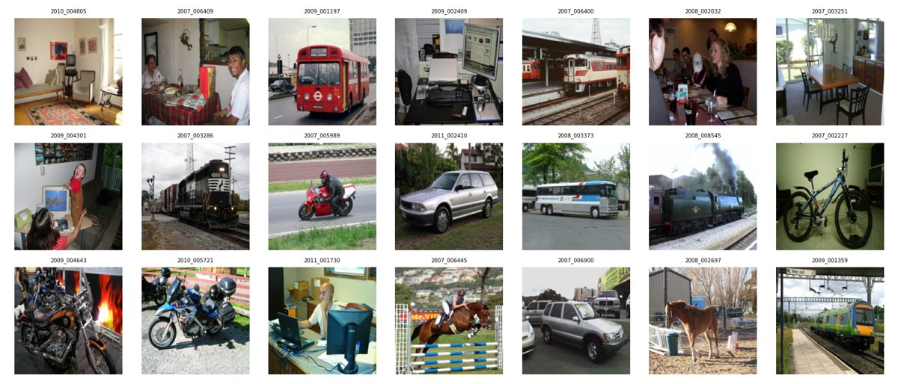
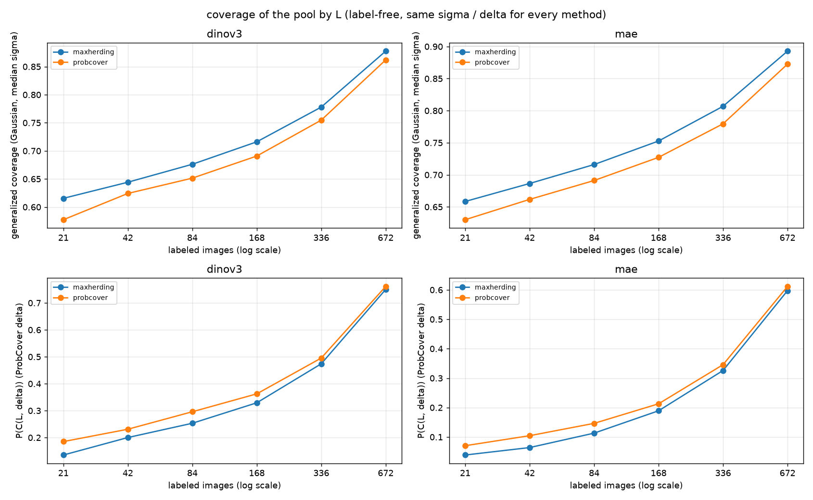
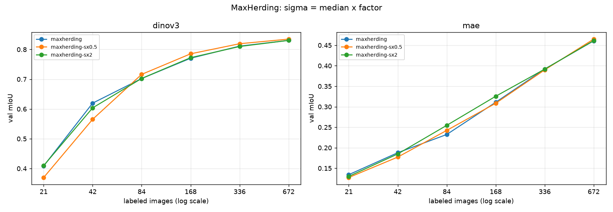
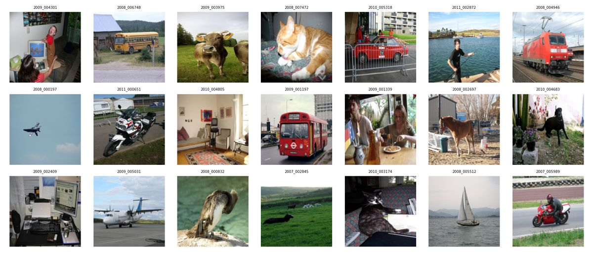

# Active learning for semantic segmentation — Pascal VOC 2012

Which images should we pay to annotate? We compare selection strategies under a fixed labeling budget,
using frozen self-supervised encoders and a small segmentation head retrained from scratch every round.

## 1. Setup

| | |
|---|---|
| **Data** | VOC 2012 seg. `train` (1464) = **pool 1264** + **dev 200** (seed 0, every class in ≥ 5 dev images). `val` (1449) is used for reporting only. Void label 255 is ignored. |
| **Oracle** | Returns masks only for queried IDs, logs every query, and refuses repeats. Selectors never get the Oracle. |
| **Encoders (frozen)** | DINOv3 ViT-B/16 (`facebook/dinov3-vitb16-pretrain-lvd1689m`, layers 6 + 12), MAE ViT-B/16 (timm `vit_base_patch16_224.mae`, layers 6 + 9). Input 448 → 28×28 tokens. |
| **Head (~0.5 M params)** | Per layer: LayerNorm → 1×1 conv 768→256. Concat → 1×1 conv 512→256 → GELU → Dropout 0.1 → 1×1 conv →21, then bilinear upsampling. |
| **Recipe (identical everywhere)** | CE loss, AdamW lr 1e-3, wd 1e-4, 50 warmup steps + cosine, batch 8, **1000 steps**, no augmentation. |
| **Budgets** | Cumulative 21 → 42 → 84 → 168 → 336 → 672 labeled images, seed 0. |
| **Cold start** | Round 0 is the **MaxHerding** batch for every model-based method (σ = median pairwise distance of mean-pooled, L2-normalised image vectors). |
| **Metrics** | val mIoU (21 classes), per-class IoU, pixel ECE (15 bins), **AUBC** (area under the mIoU vs log-budget curve, normalised), dev mIoU, cost proxies: object instances and object-boundary pixels of the selected images. |

**Uncertainty scorers.** Each method gives an uncertainty value per pixel. The image score is the mean of its top 10% most uncertain pixels, so a small uncertain object isn't averaged away by easy background.

- **RIPU:** region impurity × prediction uncertainty. It multiplies (a) the entropy of the *predicted labels* in a 3×3 window by (b) the mean softmax entropy in the same window. It's high where several classes meet *and* the model is unsure.
- **BALD:** mutual information H(mean p) − mean H(p) over **5 bootstrap heads** trained on resampled L. This is epistemic uncertainty, i.e. disagreement between the heads.

## 2. Full-data upper bound (all 1464 train images, 3 seeds)

| Encoder | val mIoU | ECE | Train time (T4) | Hardest classes (IoU) |
|---|---|---|---|---|
| DINOv3 ViT-B/16 | **85.93 ± 0.15** | 0.004 | ~117 s | chair 57.5 · pottedplant 64.3 · bicycle 68.5 |
| MAE ViT-B/16 | **49.88 ± 0.29** | 0.004 | ~116 s | chair 17.7 · pottedplant 21.4 · bicycle 28.1 |

Same model size (ViT-B/16), very different features: DINOv3 is +36 mIoU. Under the fixed 1000-step recipe MAE is still slowly improving (val 28 → 40 → 46 → 49 → 50 at steps 200…1000).

## 3. Active learning results


### val mIoU (%) per budget

| Encoder | Method | 21 | 42 | 84 | 168 | 336 | 672 | AUBC | % of full @672 |
|---|---|---|---|---|---|---|---|---|---|
| DINOv3 | Random | *TODO* | | | | | | | |
| DINOv3 | **Uncertainty top-B (RIPU)** | 40.86 | 58.88 | **71.22** | **78.01** | **83.43** | **85.65** | **70.96** | **99.7** |
| DINOv3 | Uncertainty top-B (BALD) | 40.86 | 51.46 | 49.94 | 65.65 | 78.85 | 84.86 | 61.75 | 98.8 |
| DINOv3 | MaxHerding | 40.86* | **61.97** | 70.23 | 77.05 | 81.12 | 83.05 | 70.47 | 96.6 |
| DINOv3 | UHerding | *TODO* | | | | | | | |
| DINOv3 | ProbCover (bonus) | 31.07 | 49.98 | 64.11 | 76.38 | 79.47 | 84.52 | 65.55 | 98.4 |
| DINOv3 | Full data (1464) | | | | | | 85.93 | | 100 |
| MAE | Random | *TODO* | | | | | | | |
| MAE | **Uncertainty top-B (RIPU)** | 13.43 | 18.31 | **27.19** | **35.02** | **43.24** | **48.67** | **30.96** | **97.6** |
| MAE | Uncertainty top-B (BALD) | 13.43 | 17.91 | 22.25 | 27.64 | 40.40 | 47.68 | 27.75 | 95.6 |
| MAE | MaxHerding | 13.43* | **18.79** | 23.23 | 31.09 | 39.19 | 46.08 | 28.41 | 92.4 |
| MAE | UHerding | *TODO* | | | | | | | |
| MAE | ProbCover (bonus) | 10.26 | 13.73 | 21.95 | 30.85 | 38.42 | 45.87 | 26.60 | 92.0 |
| MAE | Full data (1464) | | | | | | 49.88 | | 100 |

\* Round 0 is the shared MaxHerding cold start, so it is identical for every model-based method and for MaxHerding itself.
ProbCover is model-free and picks its own first batch. Details on both in *MaxHerding and ProbCover* below.
*Gain over Random* will be added once the Random runs are in.

### Complementary metrics (DINOv3, RIPU vs BALD)

| | 21 | 42 | 84 | 168 | 336 | 672 |
|---|---|---|---|---|---|---|
| dev mIoU, RIPU | 38.6 | 54.5 | 69.6 | 79.3 | 83.1 | 85.0 |
| dev mIoU, BALD | 38.6 | 51.3 | 48.8 | 63.2 | 74.8 | 84.5 |
| val ECE, RIPU | 0.083 | 0.047 | 0.026 | 0.021 | 0.010 | 0.006 |
| val ECE, BALD | 0.083 | 0.057 | 0.051 | 0.027 | 0.013 | 0.007 |
| objects / image in L, RIPU | 2.76 | 2.95 | 3.21 | 3.02 | 3.24 | 3.00 |
| objects / image in L, BALD | 2.76 | 2.67 | 2.32 | 2.11 | 2.27 | 2.58 |
| boundary px / image, RIPU | 1783 | 1916 | 2273 | 2613 | 2478 | 2216 |
| boundary px / image, BALD | 1783 | 1913 | 1635 | 1611 | 1824 | 1971 |

- **Choosing the scorer without val.** RIPU beats BALD on **dev** at every budget, so dev alone picks RIPU as our Uncertainty top-B method and as the uncertainty weight for UHerding. Val agrees.
- **Overfitting check.** Dev and val are evaluated every 100 steps. The val score at the best-dev step differs from the step-1000 score by at most 0.5 points across all four runs (≤ 0.26 on DINOv3), so the fixed 1000 steps don't overfit even with 21 images.
- **Selection cost.** RIPU takes ~2 s per round. BALD takes ~350 s per round because of its 5 extra heads. Each training round takes ~165 s.
- **Annotation cost.** RIPU prefers busy scenes with ~3.0–3.2 objects and more boundary per image, vs 2.1–2.7 for BALD. Each RIPU image is therefore more expensive to annotate (2015 vs 1733 objects at 672 images). RIPU still wins at an equal object count: with ~500 objects RIPU has 78.0 mIoU (168 images), while BALD has ~71 (interpolated between 355 objects → 65.7 and 762 objects → 78.9).

### MaxHerding and ProbCover (bonus)

**Methods.** Both work on the same label-free image vectors (mean-pooled patch tokens of the last layer, L2-normalised)
and use the same greedy step: pick the candidate whose kernel row adds the most to the pool's coverage, then update
coverage with a max. They differ only in the kernel.
- **MaxHerding:** Gaussian kernel with σ = median pairwise distance (DINOv3 0.410, MAE 0.598). The gain is "how much
  closer the pool gets to its nearest labeled image".
- **ProbCover (bonus, +2):** hard ball `[d(x, s) < δ]`, so the gain is the number of newly covered pool images
  (max coverage of P(C(L, δ))). δ is chosen without labels: k-means with k = 21 on the pool vectors gives pseudo-labels,
  and δ is the largest radius whose balls are pure for ≥ 95% of the pool (DINOv3 δ = 0.228, MAE δ = 0.274). Purity has a
  closed form, an order statistic of each point's distance to the nearest point of another cluster. If the pool were
  fully covered, the rest of the batch would be random as in the paper. That never happened: every pick in every round
  was greedy, and even at 672 images only ~75% (DINOv3) / ~61% (MAE) of the pool is covered.

**Learning curves.** On both encoders **MaxHerding is the best method at 42 images** (DINOv3 62.0 vs 58.9 for RIPU,
MAE 18.8 vs 18.3). From 84 images on, RIPU takes over. MaxHerding is far ahead of BALD up to 336 images on DINOv3
(70.2 vs 49.9 at 84), because a diverse batch cannot collapse onto one class like BALD's cow / train batches.
At 672 images MaxHerding is the weakest method on DINOv3 (83.1): pure diversity keeps adding typical images and rarely
the hard indoor classes (chair 50.3, diningtable 47.6 vs 58.0, 71.8 for RIPU).

**ProbCover loses the cold start, and it is visible in the batch.** Its first 21 images (DINOv3) are the densest balls
of the pool: 4 trains, 2 buses, cars, motorbikes, offices with monitors, dining rooms. It has **no aeroplane, bird, boat,
cat, cow, dog, pottedplant or sheep**, so those 8 classes have IoU 0 after round 0 (MaxHerding misses only bicycle).
Result: 31.1 vs 40.9 mIoU at 21 and 50.0 vs 62.0 at 42. On MAE ProbCover has IoU 0 for 7 classes after round 0 (MaxHerding: 2).
The gap closes by 168 images, and at 672 ProbCover is ahead of MaxHerding on DINOv3 (84.5 vs 83.1, 98.4% of full data).
On MAE the two end within 0.2.



| DINOv3 | 21 | 42 | 84 | 168 | 336 | 672 |
|---|---|---|---|---|---|---|
| dev mIoU, MaxHerding | 38.6 | 62.2 | 72.3 | 76.9 | 80.8 | 82.1 |
| dev mIoU, ProbCover | 30.4 | 47.8 | 65.9 | 74.1 | 77.4 | 83.1 |
| val ECE, MaxHerding | 0.083 | 0.046 | 0.032 | 0.020 | 0.014 | 0.011 |
| val ECE, ProbCover | 0.114 | 0.065 | 0.036 | 0.022 | 0.018 | 0.009 |
| objects / image in L, MaxHerding | 2.76 | 3.21 | 2.74 | 2.29 | 2.17 | 2.17 |
| objects / image in L, ProbCover | 3.05 | 2.69 | 2.45 | 2.69 | 2.50 | 2.24 |
| boundary px / image, MaxHerding | 1783 | 2102 | 1761 | 1624 | 1493 | 1549 |
| boundary px / image, ProbCover | 2236 | 1966 | 1861 | 1789 | 1624 | 1568 |

- **Dev agrees with val** on MaxHerding vs ProbCover at every budget, including the swap at 672.
- **Annotation cost.** Diversity methods pick simpler scenes than RIPU: ~2.2 objects / image at 672 vs 3.0 for RIPU
  (1457 objects for MaxHerding vs 2015 for RIPU). RIPU still wins at an equal object count (~84.5 mIoU at ~1460 objects,
  interpolated), but the gap shrinks from 2.6 to ~1.5 points.
- **Selection cost.** ~0.8 s in round 0 (pool kernel on a T4) and ≤ 0.1 s in later rounds, for both methods.
  ProbCover's δ search (k-means) runs once before round 0 and is not counted. Compare: RIPU ~2 s, BALD ~350 s per round.

**Coverage.** Each method wins on its own objective, measured with the same σ and δ for both (pool fraction):

| | generalized (Gaussian) coverage @21 → @672 | P(C(L, δ)) @21 → @672 |
|---|---|---|
| DINOv3, MaxHerding | **0.616** → **0.878** | 0.135 → 0.750 |
| DINOv3, ProbCover | 0.578 → 0.862 | **0.185** → **0.761** |
| MAE, MaxHerding | **0.659** → **0.893** | 0.039 → 0.597 |
| MAE, ProbCover | 0.630 → 0.873 | **0.070** → **0.612** |

Higher Gaussian coverage goes with higher mIoU at low budget. Ball coverage counts an image as covered only inside δ,
so it rewards dense clusters, which is exactly what made the ProbCover cold start less diverse.



**σ ablation (MaxHerding, σ = median × 0.5 / 1 / 2).**

| | 21 | 42 | 84 | 168 | 336 | 672 | AUBC |
|---|---|---|---|---|---|---|---|
| DINOv3, σ × 0.5 | 36.99 | 56.54 | **71.63** | **78.54** | **81.93** | **83.47** | 69.77 |
| DINOv3, σ × 1 (median) | 40.86 | **61.97** | 70.23 | 77.05 | 81.12 | 83.05 | **70.47** |
| DINOv3, σ × 2 | **40.97** | 60.38 | 70.26 | 77.25 | 80.99 | 83.05 | 70.18 |
| MAE, σ × 0.5 | 12.73 | 17.72 | 24.23 | 30.85 | 39.00 | **46.50** | 28.28 |
| MAE, σ × 1 (median) | **13.43** | **18.79** | 23.23 | 31.09 | **39.19** | 46.08 | 28.41 |
| MAE, σ × 2 | 13.01 | 18.48 | **25.46** | **32.56** | 39.18 | 46.13 | **29.05** |

The median heuristic is a safe default: no σ is better at every budget, and the AUBC spread is under 1 point.
On DINOv3 a narrow kernel (σ × 0.5) is clearly worse at 21–42 images (−4 to −5 points) and slightly better from 84 on;
on MAE σ × 2 is slightly better in the middle. One seed, so differences under ~1 point are noise.



## 4. What was selected

**Cold start (MaxHerding, 21 images, DINOv3).** The batch is diverse: indoor, animals, vehicles, a plane, a boat. It covers 19/20 object classes; only *bicycle* is missing, so bicycle IoU is 0.0 after round 0. On MAE it covers 18/20 (no cow, no horse, so both have IoU 0).



**Class composition of every batch** (fraction of batch images that contain each class):


**BALD top-B collapses onto one class at a time**, a textbook redundant batch:

| Round | Batch | What BALD picked (DINOv3) | Example top-ranked IDs (score) |
|---|---|---|---|
| r1 | 21 | **15/21 contain cow**, 4 sheep, 0 vehicles / indoor | `2010_004283` cow (0.983), `2008_000711` cow, `2007_002088` cow, `2009_003933` cow |
| r2 | 42 | **32/42 contain train**, 10 bus, a few person / car | `2009_001359` train (1.011), `2009_005084` train, `2007_009597` train |
| r5 | 336 | person 140, chair 58, horse 51, bicycle 35 | finally diverse |

Result: adding 42 train/bus images at r2 made mIoU **drop** from 51.5 to 49.9. At 84 images BALD still has bicycle IoU 0.0, chair 8.2 and diningtable 5.0, because it had never picked those classes. MAE BALD shows the same pattern: r1 is 9 sheep, 4 cow, 4 cat and no person.

**RIPU spreads out more and goes for cluttered scenes:**

| Round | Batch | What RIPU picked (DINOv3) | Example top-ranked IDs (score) |
|---|---|---|---|
| r1 | 21 | bottle 6, dog 5, car 3, sheep 3, pottedplant 2 | `2007_004768` sheep (1.41), `2010_000567` pottedplant, `2007_003267` bird, `2007_003207` bottle |
| r2 | 42 | **chair 19**, person 16, diningtable 6, cow 5, boat 4 | `2011_000652` motorbike (1.06), `2011_001753` aeroplane, `2008_000588` chair + person |
| r5 | 336 | person 128, chair 42, pottedplant 34, dog 32, tvmonitor 30 | indoor / thin-structure classes |

**Labeled images per class after 672 (RIPU / BALD, DINOv3):** person 263 / 212 · chair 108 / 92 · diningtable 65 / 54 · pottedplant 59 / 45 · horse 36 / 55 · train 23 / 35 · aeroplane 25 / 19.
RIPU over-samples the hard indoor classes; BALD over-samples the classes it got stuck on early (horse, train).

### Per-class IoU (DINOv3, %)

| Class | 21 (shared) | 84 RIPU | 84 BALD | 672 RIPU | 672 BALD | Full | # in L @672 (R / B) |
|---|---|---|---|---|---|---|---|
| bicycle | 0.0 | 21.8 | 0.0 | 67.4 | 66.6 | 68.5 | 43 / 39 |
| chair | 7.3 | 36.7 | 8.2 | 58.0 | 56.0 | 57.5 | 108 / 92 |
| diningtable | 5.1 | 51.7 | 5.0 | 71.8 | 68.9 | 70.8 | 65 / 54 |
| pottedplant | 14.9 | 40.0 | 14.4 | 65.9 | 59.3 | 64.3 | 59 / 45 |
| boat | 15.4 | 60.7 | 10.7 | 81.7 | 83.5 | 84.7 | 25 / 32 |
| cow | 51.2 | 89.7 | 88.6 | 94.7 | 95.1 | 95.4 | 29 / 24 |
| train | 57.5 | 76.3 | 71.4 | 92.2 | 90.1 | 93.1 | 23 / 35 |
| person | 76.9 | 90.0 | 80.6 | 92.7 | 92.6 | 92.8 | 263 / 212 |

With 672 images (46% of the pool) RIPU is already at or above full-data IoU for chair, diningtable and pottedplant. On MAE the biggest remaining gap is *boat* (31.1 vs 46.4 full): only 16 boat images were selected.

## 5. Takeaways so far
- **RIPU > BALD** at every budget after the cold start, on both encoders. The gap is largest at mid budget: +21.3 mIoU at 84 images on DINOv3.
- **Top-B BALD selects redundant batches** (cow → train/bus). This is exactly why diversity-aware selection is needed: MaxHerding beats BALD at every budget from 42 to 336 on DINOv3.
- **RIPU reaches 99.7% of the full-data mIoU with 672 labels** (46% of the pool) on DINOv3.
- **Diversity wins the cold start, uncertainty wins later.** MaxHerding is the best method at 42 images on both encoders;
  from 84 on RIPU is best. A hybrid (UHerding) is the natural next step.
- **ProbCover (bonus) needs more labels than MaxHerding:** its hard-ball objective prefers dense clusters, so its first
  batch misses 8 of 20 classes on DINOv3 (−9.8 mIoU at 21). It catches up by 168 and ends slightly ahead at 672 on DINOv3.
- **The median σ is a good default** for MaxHerding: ×0.5 and ×2 change AUBC by less than 1 point.
- **The encoder matters more than the selector:** every method on DINOv3 with 42 images (50–62 mIoU) beats every
  method on MAE with 672 images (46–49 mIoU).

## 6. Reproducing

### Layout
```
configs/        base.yaml (all defaults) + per-experiment overrides
scripts/        part1.sh (full-data upper bound), part2.sh (Uncertainty top-B AL: RIPU, BALD),
                part3.sh (MaxHerding, ProbCover, MaxHerding sigma ablation)
src/
  data.py       VOC ids, masks, dev split            oracle.py   Oracle + post-hoc cost proxies
  features.py   frozen encoders, feature caching (entrypoint)
  head.py       segmentation head                    metrics.py  mIoU, per-class IoU, ECE
  train.py      LightningModule, datasets, W&B weight histograms, train_head / evaluate
  selection/    herding.py (MaxHerding), probcover.py (ProbCover, bonus), uncertainty.py (RIPU, BALD),
                registry SELECTORS
  al_loop.py    AL rounds (entrypoint)               run_full.py full-data upper bound (entrypoint)
  tracking.py   results CSV, W&B run setup, head checkpoints
  report.py     learning curves, summary table (AUBC, gain over Random), cost and coverage curves (entrypoint)
kaggle/         bundle.sh (code -> private Kaggle dataset), push.sh + kernel/run.py (run commands on a Kaggle T4)
tests/          MaxHerding toy example + sanity checks, ProbCover checks, Oracle, metrics
```

Any run is reproducible from a config plus `key=value` overrides (dotted keys allowed):
```
python -m src.features encoder=dinov3
python -m src.run_full --config configs/full.yaml encoder=mae seed=1
python -m src.al_loop --config configs/uncertainty.yaml encoder=dinov3 al.scorer=bald
python -m src.al_loop --config configs/maxherding.yaml encoder=dinov3
python -m src.al_loop --config configs/maxherding.yaml encoder=dinov3 al.sigma_scale=0.5   # sigma ablation
python -m src.al_loop --config configs/probcover.yaml encoder=dinov3
python -m src.report                       # -> outputs/report/: summary.{csv,md}, learning/cost/coverage curves
```
Results are appended to `outputs/results.csv` (selector-side stats such as ProbCover delta, coverage and the number
of greedy picks go to `outputs/selector_stats.csv`); selections, cold-start batch, plots and head weights go to `outputs/`.

### Running on Kaggle from the command line
Same as assignment 1: the local working tree is uploaded as a private dataset and a script kernel runs on a T4,
no GitHub push needed. Needs `~/.kaggle/kaggle.json`. Without a `WANDB_API_KEY` secret W&B logs offline into
`repo/wandb/`. The MaxHerding / ProbCover runs and their reports are in `outputs/kaggle/part3-{mae,dinov3,combined}/`.
```
bash kaggle/bundle.sh && uvx --with six kaggle datasets create -p build/kaggle_bundle --dir-mode zip     # first time
bash kaggle/bundle.sh && uvx --with six kaggle datasets version -p build/kaggle_bundle -m update --dir-mode zip
bash kaggle/push.sh "bash scripts/part3.sh" "python -m src.report"
KERNEL=al-seg-voc-baselines bash kaggle/push.sh "ENCODERS=mae bash scripts/part1.sh"   # 2nd kernel in parallel
uvx --with six kaggle kernels status <user>/al-seg-voc
uvx --with six kaggle kernels output <user>/al-seg-voc -p build/kaggle_out
```
Kaggle secrets do not reach API-pushed kernels, so DINOv3 (gated) comes as a private dataset of its HF weights,
downloaded once locally with your own token (`build/dinov3_weights/`, with its LICENSE), and the kernel passes the
folder it finds as `encoders.dinov3.name`:
```
uvx --with six kaggle datasets create -p build/dinov3_weights --dir-mode zip
EXTRA_DATASETS=dinov3-vitb16-weights KERNEL=al-seg-voc-dinov3 bash kaggle/push.sh \
  'ENCODERS=dinov3 bash scripts/part3.sh encoders.dinov3.name=${DINOV3_DIR:?}' "python -m src.report"
```
`selector_stats.csv` also holds two label-free coverage metrics for every method, with the same median sigma and
ProbCover delta for all: generalized (Gaussian) coverage and P(C(L, delta)).


